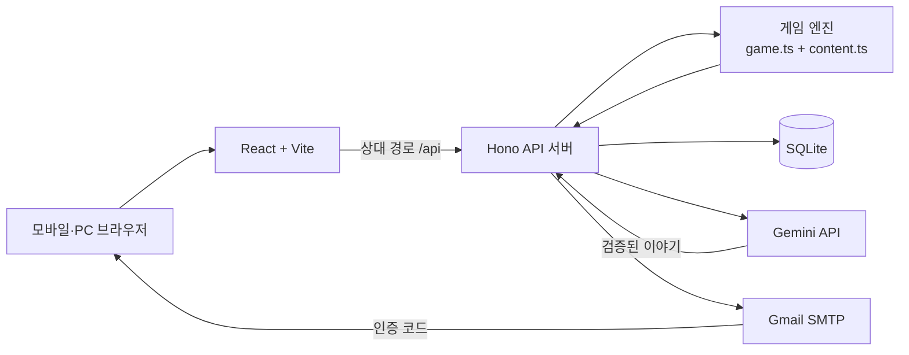

# 재수강

> 귀하의 대학생활은 재수강 대상입니다.

인천대학교 바이브코딩 대회 **팀 바코드** 출품작입니다.

대학생활의 후회를 입력하고 1학년으로 돌아가, 8학기 동안 수강신청·재수강·활동·진로를 다시 선택하는 웹 게임입니다. 게임 규칙과 결과는 코드가 계산하고, Gemini는 사용자의 후회와 플레이 기록에 맞춰 회귀 목표와 사건, 엔딩을 작성합니다.

## 문제와 해결 방향

인천대에는 학부연구생, 교환학생, 상담과 비교과 활동을 위한 공식 창구가 이미 있습니다. 저희가 풀고 싶은 문제는 **기회가 없다는 것**이 아니라, 신입생이 선택하기 전에 자격 조건과 이후 경험을 가늠하기 어렵다는 것입니다.

재수강은 실제 학교생활의 선택과 결과를 짧은 게임으로 먼저 경험하게 합니다. 장기적으로는 엔딩에서 학부연구생·교환학생·상담 등 공식 페이지로 연결해, 게임에서 발견한 선택을 현실의 다음 행동으로 이어 주는 것을 목표로 합니다.

> 현재 인천대 학생이 실제로 어떤 진입 장벽을 겪는지에 대한 직접 조사는 부족합니다. 게임이 이해도나 실제 참여를 높인다는 효과도 아직 검증하지 않았으며, 이를 완료된 성과로 주장하지 않습니다.

## 핵심 경험

- **후회 맞춤 회귀:** 학과와 후회를 바탕으로 AI가 개인별 회귀 목표를 만듭니다.
- **8학기 시뮬레이션:** 수강신청 미니게임부터 성적, 등록금, 대출, 활동, 아이템과 진로까지 선택이 누적됩니다.
- **인천대 소재:** 재수강·졸업 학점·드림이 등 학교 규칙과 소재를 게임화했습니다. 실제 적용 조건은 조사 데이터와 분리해 검토합니다.
- **결정론적 게임 규칙:** 스탯, 성적, 업적과 엔딩 조건은 코드가 계산하며 AI가 숫자를 바꾸지 않습니다.
- **대학 이메일 랭킹:** 완주 기록은 `@inu.ac.kr` 이메일 인증 후 랭킹에 등록할 수 있습니다.

## 게임 흐름

```mermaid
flowchart LR
    A[학과·캐릭터·후회 입력] --> B[AI 회귀 목표]
    B --> C[스타일·집중 능력 선택]
    C --> D[수강신청 미니게임]
    D --> E[학기 계획]
    E --> F[AI 맞춤 사건]
    F --> G[학기 성적표]
    G -->|8학기 반복| D
    G -->|졸업 처리| H[칭호·엔딩·업적]
    H --> I[@inu.ac.kr 인증·랭킹]
```

한 학기에는 다음 과정이 포함됩니다.

1. 반응속도 미니게임으로 수강 학점을 결정합니다.
2. 재수강 과목, 근로·알바·동아리·가상 연구실과 아이템을 선택합니다.
3. 현재 학과, 회귀 목표와 이전 선택을 반영한 사건을 만납니다.
4. 코드가 스탯, 이수 학점과 평점을 계산하고 학기 성적표를 발급합니다.

## 시스템 구조



- 프런트엔드는 게임 화면을 제공하고 모든 서버 요청을 상대 경로 `/api`로 보냅니다.
- 백엔드는 입력 검증, 세션, 플레이 토큰, 게임 진행과 랭킹 등록을 담당합니다.
- 게임 엔진은 같은 시드와 선택에 같은 결과를 내며, AI가 실패해도 준비된 샘플 문구로 플레이를 계속합니다.
- AI 응답은 스키마와 금칙어 검사를 통과해야 사용됩니다. 후회 원문, 닉네임과 이메일은 AI 로그에 저장하지 않습니다.
- 개발 시 Vite가 API 요청을 프록시합니다. 시연 빌드에서는 Hono 서버가 `frontend/dist`도 함께 제공합니다.

## 저장소 구조

```text
.
├── frontend/
│   └── src/
│       ├── components/        # 인증, 캐릭터 등 공통 UI
│       ├── pages/             # 시작, 플레이, 결과, 랭킹 화면
│       ├── api.ts             # API 타입과 클라이언트
│       └── App.tsx            # 프런트엔드 라우팅
├── backend/
│   └── src/
│       ├── app.ts             # API, 인증, 플레이와 랭킹
│       ├── game.ts            # 게임 계산과 판정
│       ├── content.ts         # 사건, 업적과 게임 콘텐츠
│       ├── ai.ts              # Gemini 호출, 검증과 대체 문구
│       ├── db.ts              # SQLite 스키마와 연결
│       └── mail.ts            # 학교 이메일 인증 발송
├── docs/                      # 기획, 사용자 흐름, 시연과 근거 문서
└── .local/                    # DB와 비밀 값; Git에서 제외
```

세부 기획과 설계 문서는 [문서 목록](docs/README.md)에서 확인할 수 있습니다.

## 빠른 시작

### 요구 사항

- Node.js 22.13 이상
- npm

### 설치

```bash
git clone https://github.com/jiin-jung/ob-vibe-coding.git
cd ob-vibe-coding

cd backend && npm install
cd ../frontend && npm install
```

### 개발 서버

터미널 1:

```bash
cd backend
npm run dev
```

터미널 2:

```bash
cd frontend
npm run dev
```

- 화면: http://localhost:5173
- API 상태 확인: http://localhost:8787/api/health

## 환경 변수

비밀 값은 저장소 루트의 `.local/.env`에만 저장합니다. 이 파일은 Git에 포함되지 않습니다.

```dotenv
GEMINI_API_KEY=<Gemini API 키>
GEMINI_MODEL=gemini-3.5-flash-lite
GMAIL_USER=<발송용 Gmail 계정>
GMAIL_APP_PASSWORD=<Gmail 앱 비밀번호>
PORT=8787
```

- Gemini 설정이 없거나 호출이 실패하면 화면에 표시된 샘플 문구로 진행합니다.
- Gmail 설정이 없는 개발 환경에서는 인증 코드가 백엔드 콘솔에 출력됩니다.
- 운영 환경에서는 Gmail 설정이 없으면 이메일 인증 요청이 실패합니다.

## 빌드와 검증

```bash
cd backend
npm test

cd ../frontend
npm run lint
npm run build
```

시연용 데이터와 단일 서버를 실행하려면 다음 명령을 사용합니다.

```bash
cd frontend && npm run build
cd ../backend && npm run seed && npm start
```

같은 네트워크의 휴대전화에서는 `http://<노트북 IP>:8787`로 접속합니다.

## 기술 스택

| 영역 | 기술 |
| --- | --- |
| 프런트엔드 | React, TypeScript, Vite, React Router |
| 백엔드 | Node.js, TypeScript, Hono |
| 데이터 | SQLite (`node:sqlite`) |
| 생성형 AI | Gemini (`@google/genai`) |
| 입력 검증 | Zod |
| 이메일 | Nodemailer, Gmail SMTP |
| 결과 이미지 | html-to-image |

## 학교 데이터 검토

[인천대 데이터 전달 패키지](https://github.com/jiin-jung/ob-vibe-coding/tree/chore/inu-data-handoff/docs/data)는 학교 공통 규정과 정보기술대학 자료를 출처, 적용 범위, 조건과 예외가 포함된 JSON으로 정리한 조사 스냅샷입니다.

기준 버전 `0.1.0`에는 26개 출처에서 수집한 87개 항목이 있습니다. 수집 단계 상태는 원문 확인 보고 53개, 조건부 25개, 충돌 1개, 미확인 8개입니다. 그러나 모든 항목의 서비스 검토 상태는 `pending`이며, 공개 또는 게임 판정에 승인된 실행 규칙은 아직 없습니다.

따라서 다음 원칙을 적용합니다.

- `verified`는 수집자가 원문을 확인했다는 보고이지, 모든 학생에게 적용되는 운영 승인이라는 뜻이 아닙니다.
- 학번·학과·학년도와 예외를 사람이 확인하기 전에는 조사 문장의 숫자를 게임 판정 규칙으로 자동 변환하지 않습니다.
- 게임의 시간·스탯·점수와 실제 학교 사실을 별도 데이터로 다룹니다.
- AI에는 검토가 끝난 사실만 전달하며 학사제도, 모집 조건이나 실존 인물을 만들게 하지 않습니다.
- 전달 파일의 구조와 체크섬은 `python docs/data/validate.py`로 검사할 수 있지만, 이 검사가 사실의 진위나 현재 적용 여부를 증명하지는 않습니다.

## 구현 및 검증 상태

| 구분 | 상태 |
| --- | --- |
| 8학기 선택형 게임, 수강신청 미니게임, 성적·업적·엔딩 | 구현 |
| Gemini 기반 회귀 목표·사건·엔딩과 실패 시 대체 문구 | 구현 |
| `@inu.ac.kr` 인증과 랭킹 등록 | 구현, 실제 학교 메일 수신 추가 확인 필요 |
| 학사 규정과 인천대 소재 | 게임용 단순화 구현, 조사 데이터의 운영 승인 규칙은 현재 0개 |
| 실제 기회의 공식 페이지 연결 | 다음 단계 |
| 인천대 학생의 진입 장벽과 게임 전후 이해도 변화 | 사용자 조사 필요 |

다음 검증에서는 학부연구생 기회 탐색과 지원 방법을 학생에게 직접 묻고, 플레이 전후 이해도와 공식 링크 클릭을 구분해 확인합니다. 인식 개선과 실제 지원 증가는 별도의 결과로 측정합니다.

## 참고 및 출처

대회 규칙에 따라 참고하거나 활용한 코드와 라이브러리를 기록합니다.

| 이름 | 용도 | 링크 |
| --- | --- | --- |
| React, Vite | 프런트엔드 | [React](https://react.dev), [Vite](https://vite.dev) |
| React Router | 화면 이동 | [reactrouter.com](https://reactrouter.com) |
| Hono | API 서버 | [hono.dev](https://hono.dev) |
| Google Gen AI SDK | Gemini API 호출 | [googleapis/js-genai](https://github.com/googleapis/js-genai) |
| Zod | 요청과 AI 응답 검증 | [zod.dev](https://zod.dev) |
| Nodemailer | 인증 메일 발송 | [nodemailer.com](https://nodemailer.com) |
| html-to-image | 결과 이미지 저장 | [GitHub](https://github.com/bubkoo/html-to-image) |
| Pretendard | 본문 글꼴 | [GitHub](https://github.com/orioncactus/pretendard) |
| Gasoek One | 제목 글꼴 | [Fontsource](https://fontsource.org/fonts/gasoek-one) |

게임 장르와 재미 구조는 [벤치에서 발롱까지](https://kickru.com/)와 [이번 생은 야구다!](https://slbcareer.com/)를 참고했습니다. 코드, 이름, 문구와 이미지는 가져오지 않았습니다.

인천대학교 관련 규칙과 소재의 기존 출처는 [docs/INU_FACTS.md](docs/INU_FACTS.md), 신규 조사 데이터와 검토 상태는 [데이터 전달 패키지](https://github.com/jiin-jung/ob-vibe-coding/tree/chore/inu-data-handoff/docs/data)에 기록합니다. 데이터 브랜치가 `develop`에 병합되기 전까지 신규 자료는 런타임에 사용되지 않습니다.
